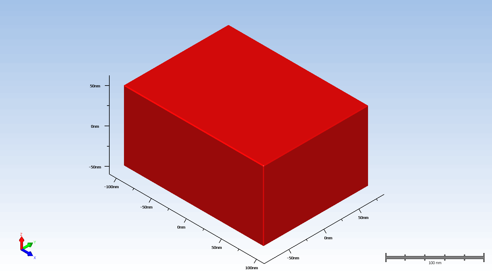

# 3D FinFET Process Simulation in SEMulator3D

This repository contains the complete project files for a 3D FinFET fabrication-process model built and executed in **Coventor SEMulator3D 13.1**. The flow starts from GDSII masks and models shallow-trench isolation, fin definition, well/source-drain doping, and gate-stack formation.



## What the model covers

- **Wafer setup:** silicon wafer at **1 nm voxel resolution**.
- **Shallow-trench isolation (STI):** pad oxide and SiN hard-mask deposition, photoresist/lithography, hard-mask and silicon trench etches, thermal oxidation, CVD oxide fill, and CMP.
- **Fin definition:** lithography, integrated multi-etch, resist strip, fin-fill deposition, and polishing.
- **Doping:** N-well formation plus P+ and N+ implantation/diffusion sequences.
- **Gate formation:** conformal **HfOx** and **TiN** deposition followed by lithography and multi-etch patterning.
- **Outputs:** the final assembly, build log, intermediate wafer-state files, process recipe, GDSII layouts, layer maps, generated Python build script, and animated visualization.

## Repository structure

```text
.
├── FinFET.gif                         # Animated process/model visualization
├── FinFET.zam                         # Final SEMulator3D assembly/model
├── __semu_FinFET.py                   # Auto-generated SEMulator3D Python build script
├── FinFET-Input/
│   ├── FinFET.vproc                   # Process-flow recipe
│   ├── FinFET.gds                     # GDSII layout
│   ├── FinFET-original.gds            # Original GDSII copy
│   ├── FinFET-layermap.txt            # Layer-map definition
│   ├── FinFET-layermap-original.txt   # Original layer map
│   ├── FinFET.zam                     # Input assembly
│   └── SEMulator3DMaterialsDatabase13.vmpd
└── FinFET-Output/
    ├── FinFET.log                     # Full build log
    └── Default Zone/                  # Intermediate/output wafer states
```

## Reproducing the build

1. Install **Coventor SEMulator3D 13.1** (or a compatible version) and ensure that the required license is available.
2. Open `FinFET.zam` and load `FinFET-Input/FinFET.vproc` with the corresponding `FinFET.gds` and layer map.
3. Check file paths before running. `__semu_FinFET.py` was auto-generated on Windows and contains absolute paths from the original machine; update these paths for your system if you use the script directly.
4. Execute the process flow and compare the run with `FinFET-Output/FinFET.log`.

The recorded build completed successfully in approximately **82 seconds** on the original machine.

## Modeling notes

The run log reports that some **1.5 nm** growth/deposition features are below two voxels at the chosen **1 nm** model resolution. SEMulator3D warns that such layers can become visually under-resolved and may affect later modeling operations. This is an important resolution limitation to account for when extending or calibrating the flow.

## Files and redistribution note

`SEMulator3DMaterialsDatabase13.vmpd` appears to be a vendor-provided SEMulator3D materials database bundled with the exported project. **Before making this repository public, verify that your SEMulator3D/Coventor license permits redistribution of that file.** If redistribution is not permitted, remove it from the public repository and document it as a prerequisite instead.

## Portfolio summary

This project demonstrates hands-on use of process emulation to connect layout masks with a 3D semiconductor fabrication flow, including deposition, lithography, etch, CMP, implantation, diffusion, and high-k/metal-gate formation.
